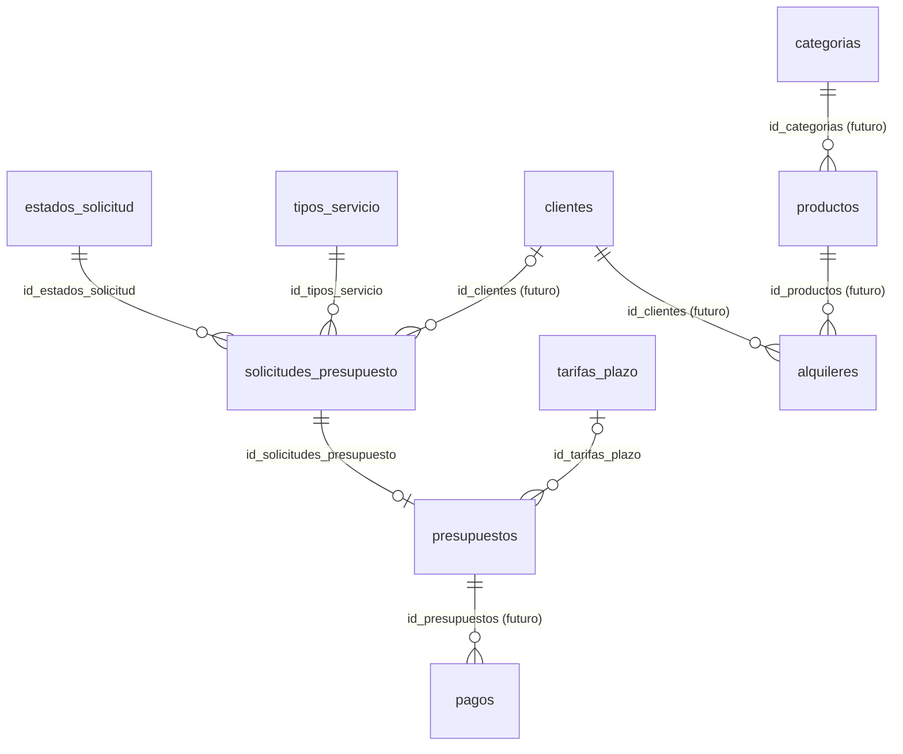

# Base de datos — Elegancia a Medida

Base: `elegancia_a_medida` · Motor: InnoDB · Cotejamiento: `utf8mb4_general_ci`
Script de creación: `elegancia_a_medida.sql`. Al reimportarlo se borran las tablas y se vuelven a crear.

## Convenciones de nombres

| Qué | Regla | Ejemplo |
|---|---|---|
| Tabla | plural, snake_case | `solicitudes_presupuesto` |
| Clave primaria | `id_` + nombre de la tabla | `usuarios.id_usuarios` |
| Clave foránea | **el mismo nombre** que la clave primaria a la que apunta | `presupuestos.id_solicitudes_presupuesto` → `solicitudes_presupuesto.id_solicitudes_presupuesto` |
| Índice | `idx_<tabla>_<columnas>` | `idx_solicitudes_estado_fecha` |
| Único | `uq_<tabla>_<columna>` | `uq_presupuestos_solicitud` |
| Restricción de clave foránea | `fk_<tabla>_<referencia>` | `fk_presupuestos_solicitud` |
| Dinero | `DECIMAL(10,2)` | `monto_total` |
| Sí/No | `TINYINT(1)` 0/1 | `activo`, `leido` |

Así, cuando en una tabla ves `id_clientes`, sabés que apunta a la tabla `clientes`.

## Todas las claves

| Tabla | Clave primaria | Claves foráneas (→ tabla) |
|---|---|---|
| `estados_solicitud` | `id_estados_solicitud` | — |
| `tipos_servicio` | `id_tipos_servicio` | — |
| `solicitudes_presupuesto` | `id_solicitudes_presupuesto` | `id_estados_solicitud` → estados_solicitud · `id_tipos_servicio` → tipos_servicio · `id_clientes` → clientes |
| `tarifas_plazo` | `id_tarifas_plazo` | — |
| `presupuestos` | `id_presupuestos` | `id_solicitudes_presupuesto` → solicitudes_presupuesto · `id_tarifas_plazo` → tarifas_plazo |
| `clientes` | `id_clientes` | — |
| `usuarios` | `id_usuarios` | — |
| `categorias` | `id_categorias` | — |
| `productos` | `id_productos` | `id_categorias` → categorias |
| `mensajes_contacto` | `id_mensajes_contacto` | — |
| `alquileres` | `id_alquileres` | `id_productos` → productos · `id_clientes` → clientes |
| `pagos` | `id_pagos` | `id_presupuestos` → presupuestos |

## Diagrama

## Tablas en uso

### 1. `estados_solicitud`
Catálogo de estados. **Los valores de `id_estados_solicitud` tienen que coincidir con las constantes `ESTADO_*` de `config.php`.**

| id_estados_solicitud | nombre | Cuándo |
|---|---|---|
| 1 | Pendiente | El cliente acaba de enviar la solicitud |
| 6 | Presupuestado | La modista cargó fecha de entrega y monto |
| 2 | En proceso | El cliente aceptó el presupuesto |
| 3 | Completado | Trabajo entregado |
| 4 | Cancelado | El cliente no aceptó, o se canceló durante el trabajo |
| 5 | Rechazado | La modista no toma el trabajo |

Recorrido: `Pendiente → Presupuestado → En proceso → Completado`. Desde Pendiente también se puede **Rechazar**, y Cancelado/Rechazado se pueden **Reabrir** (vuelven a Pendiente).
**Usada en:** `modista.php` (vía `config.php`), `actualizar_estado.php`, `guardar_presupuesto.php`.

### 2. `tipos_servicio`
| Columna | Tipo | Nota |
|---|---|---|
| id_tipos_servicio | TINYINT UNSIGNED PK | 1 Confección · 2 Arreglos · 3 Diseño personalizado · 4 Otro |
| nombre | VARCHAR(50) único | |
| activo | TINYINT(1) | 0 = no aparece en el formulario (no borrar filas usadas) |

**Usada en:** `index.php` (desplegable), `procesar_presupuesto.php` (validación), `modista.php`, `presupuesto.php`.

### 3. `solicitudes_presupuesto`
Lo que carga el cliente.

| Columna | Tipo | Nota |
|---|---|---|
| id_solicitudes_presupuesto | INT UNSIGNED PK | |
| id_clientes | INT UNSIGNED NULL → `clientes` | NULL hasta que exista el login de clientes |
| nombre | VARCHAR(100) | |
| telefono | VARCHAR(30) | |
| id_tipos_servicio | TINYINT UNSIGNED → `tipos_servicio` | |
| tipo_prenda | VARCHAR(100) | |
| descripcion | TEXT | máximo 1000 caracteres (lo controla PHP) |
| fecha_requerida | DATE | fecha que pide el cliente; máximo hoy + 180 días |
| fecha_solicitud | TIMESTAMP | automática |
| id_estados_solicitud | TINYINT UNSIGNED → `estados_solicitud` | por defecto 1 (Pendiente) |

**Usada en:** `procesar_presupuesto.php` (INSERT), `modista.php`, `presupuesto.php`, `actualizar_estado.php`, `guardar_presupuesto.php`.

### 4. `tarifas_plazo`
Lo que cobra la modista según el plazo. Para un plazo de N días se toma la fila con el **menor `dias_hasta` que sea ≥ N**. Si `dias_hasta` es NULL, la fila cubre cualquier plazo (es la tarifa "sin límite").

| Columna | Tipo | Nota |
|---|---|---|
| id_tarifas_plazo | SMALLINT UNSIGNED PK | |
| nombre | VARCHAR(50) | Urgente, Rápido, Normal… |
| dias_hasta | SMALLINT UNSIGNED NULL, único | NULL = sin límite (solo una fila) |
| recargo_porcentaje | DECIMAL(5,2) | entre −50 y 300; negativo = descuento |

Valores iniciales: Urgente ≤ 7 días +40 % · Rápido ≤ 15 días +20 % · Normal (sin límite) 0 %.
**Usada en:** `tarifas.php`, `guardar_tarifa.php`, `presupuesto.php`, `guardar_presupuesto.php`.

### 5. `presupuestos`
Respuesta de la modista. Hay **una por solicitud**: si se edita, se actualiza la misma fila.

| Columna | Tipo | Nota |
|---|---|---|
| id_presupuestos | INT UNSIGNED PK | |
| id_solicitudes_presupuesto | INT UNSIGNED único → `solicitudes_presupuesto` | si se borra la solicitud, se borra el presupuesto |
| id_tarifas_plazo | SMALLINT UNSIGNED NULL → `tarifas_plazo` | queda NULL si después se borra la tarifa |
| monto_base | DECIMAL(10,2) | precio del trabajo sin recargo |
| fecha_entrega | DATE | elegida por la modista |
| plazo_dias | SMALLINT UNSIGNED | días desde el presupuesto hasta la entrega |
| recargo_porcentaje | DECIMAL(5,2) | se guarda fijo en el momento del presupuesto |
| monto_total | DECIMAL(10,2) | `monto_base × (100 + recargo) / 100` |
| observaciones | VARCHAR(500) | |
| fecha_creacion | TIMESTAMP | automática |
| fecha_actualizacion | DATETIME NULL | se completa al editar |

> El recargo y el total se guardan fijos: si la modista cambia las tarifas, los presupuestos ya hechos **no cambian**.

## Tablas de evolución posterior (vacías)

Se crean vacías para dejar fijos los nombres y las claves. Ningún archivo PHP las usa todavía, y conviene revisar sus columnas cuando se implemente cada función.

| # | Tabla | Para | Columnas principales |
|---|---|---|---|
| 6 | `clientes` | registro/login de clientes, historial de pedidos | nombre, telefono, email, clave_hash |
| 7 | `usuarios` | login de la modista/admin | nombre, email, clave_hash, rol (modista/admin) |
| 8 | `categorias` | catálogo | nombre, descripcion |
| 9 | `productos` | catálogo y ABM | id_categorias, nombre, precio_venta, precio_alquiler, imagen |
| 10 | `mensajes_contacto` | formulario de contacto | nombre, telefono, email, mensaje, leido |
| 11 | `alquileres` | alquiler de prendas | id_productos, id_clientes, fecha_retiro, fecha_devolucion, monto |
| 12 | `pagos` | señas y saldos | id_presupuestos, monto, metodo, concepto (seña/saldo/total) |

## Dónde tocar cuando se modifica algo

| Si cambia… | Tocar también |
|---|---|
| Un estado (agregar o renombrar) | `estados_solicitud` **y** `ESTADOS` / `ESTADO_*` / `TRANSICIONES` en `config.php` |
| Un tipo de servicio | Solo la tabla `tipos_servicio` |
| Lo que se cobra por plazo | Desde el panel: **Tarifas por plazo** (`tarifas.php`) |
| Longitud de una columna | El `CREATE TABLE` y la constante `*_MAX` de `config.php` |
| Rango de fecha del cliente | `FECHA_MAX_DIAS` en `config.php` |
| Plazo máximo de entrega | `PLAZO_MAX_DIAS` en `config.php` |
| Una tabla nueva | Clave primaria `id_<tabla>`; quien la referencie usa ese mismo nombre |
