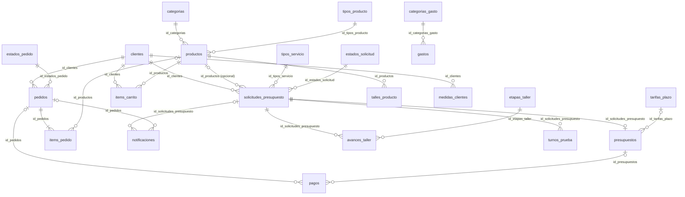

# Base de datos — Elegancia a Medida

Base: `elegancia_a_medida` · Motor: InnoDB · Cotejamiento: `utf8mb4_general_ci`
Script de creación: `elegancia_a_medida.sql`. Al reimportarlo se borran las tablas y se vuelven a crear.

## Convenciones de nombres

| Qué | Regla | Ejemplo |
|---|---|---|
| Tabla | plural, snake_case | `solicitudes_presupuesto` |
| Clave primaria | `id_` + nombre de la tabla | `usuarios.id_usuarios` |
| Clave foránea | **el mismo nombre** que la clave primaria a la que apunta | `presupuestos.id_solicitudes_presupuesto` → `solicitudes_presupuesto.id_solicitudes_presupuesto` |
| Índice | `idx_<tabla>_<columnas>` | `idx_solicitudes_estado_fecha` |
| Único | `uq_<tabla>_<columna>` | `uq_clientes_email` |
| Restricción de clave foránea | `fk_<tabla>_<referencia>` | `fk_productos_categoria` |
| Dinero | `DECIMAL(10,2)` | `monto_total` |
| Sí/No | `TINYINT(1)` 0/1 | `activo`, `leida` |
| Contraseñas | `clave_hash` con `password_hash()` | nunca la clave en texto |

Así, cuando en una tabla ves `id_clientes`, sabés que apunta a la tabla `clientes`.

## Todas las claves

| # | Tabla | Clave primaria | Claves foráneas (→ tabla) |
|---|---|---|---|
| 1 | `estados_solicitud` | `id_estados_solicitud` | — |
| 2 | `tipos_servicio` | `id_tipos_servicio` | — |
| 3 | `clientes` | `id_clientes` | — |
| 4 | `usuarios` | `id_usuarios` | — |
| 5 | `categorias` | `id_categorias` | — |
| 6 | `tipos_producto` | `id_tipos_producto` | — |
| 7 | `productos` | `id_productos` | `id_categorias` → categorias · `id_tipos_producto` → tipos_producto |
| 8 | `solicitudes_presupuesto` | `id_solicitudes_presupuesto` | `id_clientes` → clientes · `id_productos` → productos (opcional) · `id_tipos_servicio` → tipos_servicio · `id_estados_solicitud` → estados_solicitud |
| 9 | `tarifas_plazo` | `id_tarifas_plazo` | — |
| 10 | `presupuestos` | `id_presupuestos` | `id_solicitudes_presupuesto` → solicitudes_presupuesto · `id_tarifas_plazo` → tarifas_plazo |
| 11 | `estados_pedido` | `id_estados_pedido` | — |
| 12 | `pedidos` | `id_pedidos` | `id_clientes` → clientes · `id_estados_pedido` → estados_pedido |
| 13 | `items_pedido` | `id_items_pedido` | `id_pedidos` → pedidos · `id_productos` → productos (queda NULL si se borra) |
| 14 | `items_carrito` | `id_items_carrito` | `id_clientes` → clientes · `id_productos` → productos |
| 15 | `notificaciones` | `id_notificaciones` | `id_solicitudes_presupuesto` → solicitudes_presupuesto · `id_pedidos` → pedidos · `id_estados_solicitud` → estados_solicitud |
| 16 | `datos_sitio` | `id_datos_sitio` (siempre 1) | — |
| 17 | `banners` | `id_banners` | — |
| 18 | `mensajes_contacto` | `id_mensajes_contacto` | — |
| 19 | `pagos` | `id_pagos` | `id_pedidos` → pedidos · `id_presupuestos` → presupuestos (uno de los dos) |
| 20 | `talles_producto` | `id_talles_producto` | `id_productos` → productos |
| 21 | `medidas_clientes` | `id_medidas_clientes` | `id_clientes` → clientes |
| 22 | `categorias_gasto` | `id_categorias_gasto` | — |
| 23 | `gastos` | `id_gastos` | `id_categorias_gasto` → categorias_gasto · `id_solicitudes_presupuesto` → solicitudes_presupuesto (opcional) |
| 24 | `arreglos` | `id_arreglos` | — |
| 25 | `etapas_taller` | `id_etapas_taller` | — |
| 26 | `avances_taller` | `id_avances_taller` | `id_solicitudes_presupuesto` → solicitudes_presupuesto · `id_etapas_taller` → etapas_taller |
| 27 | `turnos_prueba` | `id_turnos_prueba` | `id_solicitudes_presupuesto` → solicitudes_presupuesto |
| 28 | `horarios_recepcion` | `id_horarios_recepcion` | — |
| 29 | `dias_sin_atencion` | `fecha` | — |
| 30 | `materiales_presupuesto` | `id_materiales_presupuesto` | `id_presupuestos` → presupuestos |

## Diagrama

`usuarios`, `datos_sitio`, `banners` y `mensajes_contacto` no se relacionan con otras tablas.

## Tablas en uso

### 1. `estados_solicitud`
**Los valores de `id_estados_solicitud` tienen que coincidir con las constantes `ESTADO_*` de `config.php`.**

| id | nombre | Quién la pone en ese estado |
|---|---|---|
| 1 | Pendiente | El cliente al enviar (o la modista al reabrir) |
| 6 | Presupuestado | La modista al cargar el presupuesto |
| 2 | En proceso | **El cliente** al aceptar el presupuesto |
| 7 | No aceptado | **El cliente** al rechazar el presupuesto |
| 3 | Completado | La modista |
| 4 | Cancelado | La modista |
| 5 | Rechazado | La modista (no toma el trabajo) |

Los botones que tiene la modista en cada estado están en `TRANSICIONES` (`config.php`). Aceptar y rechazar el presupuesto **no** están ahí: solo los puede hacer el cliente (`responder_presupuesto.php`).

### 2. `tipos_servicio`
| Columna | Tipo | Nota |
|---|---|---|
| id_tipos_servicio | TINYINT UNSIGNED PK | 1 Confección · 2 Arreglos · 3 Diseño personalizado · 4 Otro |
| nombre | VARCHAR(50) único | |
| activo | TINYINT(1) | 0 = no aparece en el formulario |

### 3. `clientes`
| Columna | Tipo | Nota |
|---|---|---|
| id_clientes | INT UNSIGNED PK | |
| nombre, telefono | VARCHAR(100), VARCHAR(30) | se copian a cada solicitud |
| email | VARCHAR(150) único | se usa para ingresar |
| clave_hash | VARCHAR(255) | `password_hash()` |
| activo | TINYINT(1) | 0 = no puede ingresar |
| intentos_fallidos, bloqueado_hasta | TINYINT, DATETIME NULL | 5 fallos → bloqueo de 15 min |
| ultimo_acceso, fecha_alta | DATETIME NULL, TIMESTAMP | |

**Usada en:** `registro.php`, `login.php`, todas las páginas del cliente (sesión).

### 4. `usuarios`
Cuentas del panel (la modista). Mismas columnas de acceso que `clientes`, más:

| Columna | Tipo | Nota |
|---|---|---|
| id_usuarios | INT UNSIGNED PK | |
| debe_cambiar_clave | TINYINT(1) | 1 = en el próximo ingreso tiene que elegir una clave nueva |

Usuario inicial: `modista@elegancia.com` / `Modista2026` (provisoria).
**Usada en:** `panel_login.php`, `panel_clave.php` y todas las páginas del panel (`requerir_modista()`).

### 5. `categorias`
La ocasión o línea de la prenda (Fiesta, Novias, Sastrería, Egresados, Día a día). Arman el menú Shop / Alquiler y los filtros de la tienda.
| Columna | Tipo | Nota |
|---|---|---|
| id_categorias | SMALLINT UNSIGNED PK | |
| nombre | VARCHAR(60) único | |
| descripcion | VARCHAR(255) | |
| activo | TINYINT(1) | 0 = oculta del catálogo (con todos sus productos) |

No se puede borrar una categoría con productos (`ON DELETE RESTRICT`).
**Usada en:** `categorias.php`, `guardar_categoria.php`, `encabezado_cliente.php`, `tienda.php`, `productos.php`, `producto.php`.

### 6. `tipos_producto`
Qué es cada prenda (Vestido, Traje / saco, Conjunto, Falda, Pantalón, Accesorio). Arman el menú y el filtro «Tipo de prenda» de la tienda; en Arreglos se usan como prenda a arreglar.

| Columna | Tipo | Nota |
|---|---|---|
| id_tipos_producto | SMALLINT UNSIGNED PK | |
| nombre | VARCHAR(60) único | |
| activo | TINYINT(1) | 0 = oculta todos sus productos del sitio |

No se puede borrar un tipo con productos. **Usada en:** `categorias.php`, `guardar_categoria.php`, `encabezado_cliente.php`, `tienda.php`, `producto.php`.

### 7. `productos`
| Columna | Tipo | Nota |
|---|---|---|
| id_productos | INT UNSIGNED PK | |
| id_categorias | SMALLINT UNSIGNED → `categorias` | |
| id_tipos_producto | SMALLINT UNSIGNED → `tipos_producto` | |
| nombre | VARCHAR(100) | |
| descripcion | TEXT | máximo 1000 caracteres (lo controla PHP) |
| en_venta / precio_venta | TINYINT(1) / DECIMAL(10,2) NULL | se vende; precio NULL = "A consultar" |
| en_alquiler / precio_alquiler | TINYINT(1) / DECIMAL(10,2) NULL | se alquila; precio NULL = "A consultar". Al menos una de las dos modalidades (CHECK) |
| descuento_porcentaje | TINYINT UNSIGNED | 0 = sin oferta; hasta 90 % |
| oferta_hasta | DATE NULL | último día de la oferta; NULL = sin fecha de fin |
| de_temporada | TINYINT(1) | 1 = aparece en la sección de temporada |
| imagen | VARCHAR(255) NULL | nombre del archivo en `img/productos/` (las `ejemplo_*.jpg` son de muestra) |
| activo | TINYINT(1) | 0 = oculto del catálogo |
| fecha_alta, fecha_actualizacion | TIMESTAMP, DATETIME NULL | |

Una oferta está **vigente** si `descuento_porcentaje > 0` y (`oferta_hasta` es NULL o es hoy o después). La regla está en `sql_oferta_vigente()` y `oferta_vigente()` (`funciones.php`).
**Usada en:** `index.php`, `tienda.php`, `prenda.php`, `carrito.php`, `productos.php`, `producto.php`, `guardar_producto.php`, `solicitud.php` (prenda de referencia).

### 8. `solicitudes_presupuesto`
| Columna | Tipo | Nota |
|---|---|---|
| id_solicitudes_presupuesto | INT UNSIGNED PK | |
| id_clientes | INT UNSIGNED → `clientes` | **obligatorio**: solo con cuenta se pide presupuesto |
| id_productos | INT UNSIGNED NULL → `productos` | prenda del catálogo usada como referencia; queda NULL si se borra el producto |
| codigo_seguimiento | CHAR(8) único | número corto de la solicitud (ej. `7K3Q-X9PA`) |
| nombre, telefono | VARCHAR | copia de los datos de la cuenta al momento de pedir |
| id_tipos_servicio | TINYINT UNSIGNED → `tipos_servicio` | |
| tipo_prenda | VARCHAR(100) | |
| descripcion | TEXT | 10 a 1000 caracteres |
| fecha_requerida | DATE | entre hoy y hoy + 180 días |
| fecha_solicitud | TIMESTAMP | automática |
| id_estados_solicitud | TINYINT UNSIGNED → `estados_solicitud` | por defecto 1 (Pendiente) |

**Usada en:** `solicitud.php`, `procesar_presupuesto.php` (INSERT), `mis_solicitudes.php`, `seguimiento.php`, `responder_presupuesto.php`, `modista.php`, `presupuesto.php`, `actualizar_estado.php`.

### 9. `tarifas_plazo`
Para un plazo de N días se toma la fila con el **menor `dias_hasta` que sea ≥ N**. `dias_hasta` NULL = sin límite.

| Columna | Tipo | Nota |
|---|---|---|
| id_tarifas_plazo | SMALLINT UNSIGNED PK | |
| nombre | VARCHAR(50) | Urgente, Rápido, Normal… |
| dias_hasta | SMALLINT UNSIGNED NULL, único | |
| recargo_porcentaje | DECIMAL(5,2) | entre −50 y 300; negativo = descuento |

Valores iniciales: Urgente ≤ 7 días +40 % · Rápido ≤ 15 días +20 % · Normal 0 %.

### 10. `presupuestos`
Uno por solicitud (si la modista lo corrige, se actualiza la misma fila).

| Columna | Tipo | Nota |
|---|---|---|
| id_presupuestos | INT UNSIGNED PK | |
| id_solicitudes_presupuesto | INT UNSIGNED único → `solicitudes_presupuesto` | |
| id_tarifas_plazo | SMALLINT UNSIGNED NULL → `tarifas_plazo` | |
| monto_base | DECIMAL(10,2) | precio sin recargo |
| fecha_entrega, plazo_dias | DATE, SMALLINT | los elige la modista |
| recargo_porcentaje, monto_total | DECIMAL | se guardan fijos; `monto_total = monto_base × (100 + recargo) / 100` |
| observaciones | VARCHAR(500) | |
| nota_materiales | VARCHAR(255) | por qué sugiere esa tela o esos materiales (la ve la clienta) |
| materiales_quien | ENUM('','clienta','modista') | quién consigue los materiales; lo elige la clienta al aceptar |
| monto_materiales | DECIMAL(10,2) | costo de los materiales sumado al total si los compra la modista |
| fecha_respuesta_cliente | DATETIME NULL | cuándo el cliente aceptó o rechazó |
| comentario_cliente | VARCHAR(300) | motivo opcional del rechazo (lo ve la modista) |
| fecha_creacion, fecha_actualizacion | TIMESTAMP, DATETIME NULL | |

### 11. `estados_pedido`
**Los valores tienen que coincidir con las constantes `PEDIDO_*` de `config.php`.** Los botones de la modista en cada estado están en `TRANSICIONES_PEDIDO`.

| id | nombre | Quién lo pone |
|---|---|---|
| 1 | Pendiente | El cliente al confirmar el carrito |
| 2 | Confirmado | La modista |
| 3 | Listo para retirar | La modista |
| 4 | Entregado | La modista |
| 5 | Devuelto | La modista (solo si el pedido tiene prendas en alquiler) |
| 6 | Cancelado | **El cliente**, solo mientras está Pendiente |
| 7 | Rechazado | La modista |

### 12. `pedidos`
Se crea cuando el cliente confirma el carrito (`confirmar_pedido.php`). No hay pago en línea: la modista confirma y arregla el pago en persona.

| Columna | Tipo | Nota |
|---|---|---|
| id_pedidos | INT UNSIGNED PK | |
| id_clientes | INT UNSIGNED → `clientes` | |
| codigo | CHAR(8) único | número corto del pedido (ej. `A552-7S4X`) |
| id_estados_pedido | TINYINT UNSIGNED → `estados_pedido` | por defecto 1 (Pendiente) |
| fecha_retiro, fecha_devolucion | DATE NULL | solo si hay prendas en alquiler (máx. 30 días) |
| comentario_cliente | VARCHAR(500) | aclaraciones (talle, etc.) |
| nota_modista | VARCHAR(500) | la ve el cliente en «Mis pedidos» |
| total_estimado | DECIMAL(10,2) | suma de los ítems con precio |
| tiene_a_consultar | TINYINT(1) | 1 = algún ítem no tiene precio |
| fecha_pedido, fecha_actualizacion | TIMESTAMP, DATETIME NULL | |

**Usada en:** `confirmar_pedido.php`, `mis_pedidos.php`, `cancelar_pedido.php`, `pedidos.php`, `actualizar_pedido.php`.

### 13. `items_pedido`
Las prendas de cada pedido. Nombre y precio se **copian** al confirmar: si después cambia el catálogo, el pedido no cambia.

| Columna | Tipo | Nota |
|---|---|---|
| id_items_pedido | INT UNSIGNED PK | |
| id_pedidos | INT UNSIGNED → `pedidos` | se borra con el pedido |
| id_productos | INT UNSIGNED NULL → `productos` | NULL si se borró el producto |
| nombre_producto | VARCHAR(100) | copia |
| modalidad | ENUM('venta','alquiler') | |
| talle | VARCHAR(12) | talle elegido, «A medida» o vacío (prenda sin guía de talles) |
| medidas | VARCHAR(255) | si es «A medida», copia de las medidas de la clienta al confirmar |
| cantidad | TINYINT UNSIGNED | 1 a 10 |
| precio_unitario | DECIMAL(10,2) NULL | con el descuento aplicado; NULL = a consultar |
| descuento_porcentaje | TINYINT UNSIGNED | el que tenía al confirmar |

### 14. `items_carrito`
El carrito de cada cliente (se guarda en la base, así no se pierde al cerrar el navegador). Solo para prendas **en venta o en alquiler**; confección y arreglos van por el formulario de presupuesto.

| Columna | Tipo | Nota |
|---|---|---|
| id_items_carrito | INT UNSIGNED PK | |
| id_clientes | INT UNSIGNED → `clientes` | |
| id_productos | INT UNSIGNED → `productos` | |
| modalidad | ENUM('venta','alquiler') | |
| talle | VARCHAR(12) | talle elegido, «A medida» (solo venta) o vacío |
| cantidad | TINYINT UNSIGNED | 1 a 10 (`CARRITO_CANT_MAX`) |
| fecha_agregado | DATETIME | para el aviso «Deshacer» de 5 minutos (`CARRITO_DESHACER_MIN`) |

Único por cliente + producto + modalidad + talle: agregar dos veces lo mismo suma la cantidad; otro talle es otra fila.
**Usada en:** `carrito_accion.php`, `carrito.php`, `confirmar_pedido.php`, `encabezado_cliente.php` (número del ícono).

### 15. `notificaciones`
Avisos al cliente. Cada aviso es de una **solicitud** (`id_solicitudes_presupuesto`) **o** de un **pedido** (`id_pedidos`): una de las dos columnas queda NULL. Se crean con `notificar()` / `notificar_pedido()` (`funciones.php`), con los textos de `NOTIFICACIONES` / `NOTIFICACIONES_PEDIDO` (`config.php`).

| Columna | Tipo | Nota |
|---|---|---|
| id_notificaciones | INT UNSIGNED PK | |
| id_solicitudes_presupuesto | INT UNSIGNED NULL → `solicitudes_presupuesto` | |
| id_pedidos | INT UNSIGNED NULL → `pedidos` | |
| id_estados_solicitud | TINYINT UNSIGNED NULL → `estados_solicitud` | estado al que pasó la solicitud |
| titulo, mensaje | VARCHAR(100), VARCHAR(500) | |
| leida, fecha_lectura | TINYINT(1), DATETIME NULL | se marca al abrir la solicitud o «Mis pedidos» |
| fecha_creacion | TIMESTAMP | |

> MariaDB no permite un `CHECK` sobre columnas con clave foránea en cascada, por eso la regla «una de las dos» la controla PHP.

### 16. `datos_sitio`
Una sola fila (`id_datos_sitio = 1`). La modista la edita en el panel: **Datos del sitio** (`sitio.php`).

| Columna | Nota |
|---|---|
| logo | archivo en `img/sitio/`; NULL = se muestra el nombre «Elegancia a Medida» en texto |
| historia_titulo, historia_texto, nombre_modista | sección «Nuestra historia» del inicio |
| temporada_titulo | título de la sección de temporada |
| whatsapp, telefono, email, instagram, facebook, direccion, horarios | sección «Contacto» y pie de página; lo vacío no se muestra |

**Usada en:** `encabezado_cliente.php`, `encabezado_modista.php`, `index.php`, `pie_cliente.php`, `sitio.php`, `guardar_sitio.php`.

### 17. `banners`
Las pantallas grandes del inicio (carrusel: Bienvenidos, Venta, Alquiler, Accesorios) y los recuadros de abajo (mosaico). Panel → **Portada**.

| Columna | Tipo | Nota |
|---|---|---|
| id_banners | SMALLINT UNSIGNED PK | |
| ubicacion | ENUM('carrusel','mosaico') | |
| titulo, subtitulo | VARCHAR(60), VARCHAR(160) | |
| texto_boton, enlace | VARCHAR(30), VARCHAR(255) | enlace = página del sitio o `https://` (lo controla `enlace_seguro()`) |
| imagen | VARCHAR(255) NULL | archivo en `img/banners/`; sin imagen se ve un degradado |
| orden | SMALLINT | flechas ↑ ↓ del panel |
| activo | TINYINT(1) | 0 = oculto |

**Usada en:** `index.php`, `banners.php`, `banner.php`, `guardar_banner.php`.

### 19. `pagos`
Las **señas** (por defecto el 50 %, `SENA_PORCENTAJE`). Cada fila es de **un pedido** (`id_pedidos`) **o** de **un presupuesto** (`id_presupuestos`); la otra columna queda NULL (lo controla PHP, igual que en `notificaciones`).

| Columna | Tipo | Nota |
|---|---|---|
| id_pagos | INT UNSIGNED PK | |
| id_pedidos | INT UNSIGNED NULL → `pedidos` | seña de un pedido del carrito |
| id_presupuestos | INT UNSIGNED NULL → `presupuestos` | seña de un presupuesto aceptado |
| concepto | ENUM('sena','saldo','total') | `sena` = la seña; `saldo` = lo que paga después (se registra en la cuenta corriente) |
| monto | DECIMAL(10,2) | > 0 |
| metodo | ENUM('mercadopago','simulado','efectivo','transferencia') | efectivo y transferencia los registra la modista |
| estado | ENUM('pendiente','aprobado','rechazado','devuelto') | solo los **aprobados** cuentan como pagados; **devuelto** = la modista le devolvió la plata (pedido rechazado o cancelado) |
| referencia | CHAR(24) único | `external_reference` que viaja a Mercado Pago (ej. `EAM-3f9a…`) |
| mp_preference_id | VARCHAR(100) NULL | id de la preferencia de Checkout Pro |
| mp_payment_id | VARCHAR(40) NULL único | número de operación de Mercado Pago (un pago no sirve para dos señas) |
| mp_estado_detalle | VARCHAR(60) | `status_detail` de Mercado Pago (ej. `accredited`) |
| observaciones | VARCHAR(255) | nota de la modista en los cobros manuales |
| fecha_creacion, fecha_pago, fecha_devolucion | TIMESTAMP, DATETIME NULL | cuándo se creó, cuándo quedó aprobado y cuándo se devolvió |

Lo que falta de la seña se calcula así: `seña = total × SENA_PORCENTAJE / 100` menos la suma de los pagos aprobados (`estado_sena()` en `funciones_pagos.php`). El total es `pedidos.total_estimado` o `presupuestos.monto_total`.
**Usada en:** `funciones_pagos.php`, `pagar_sena.php`, `pago_resultado.php`, `verificar_pago.php`, `pago_webhook.php`, `pago_simulado.php`, `pagos.php`, `registrar_pago.php`, `mis_pedidos.php`, `seguimiento.php`, `pedidos.php`, `modista.php`.

### 20. `talles_producto`
La **guía de talles** de cada prenda: cada talle (S, M, L o 38, 40…) con las **medidas del cuerpo** que le quedan bien, en centímetros. Así la clienta elige por medidas y no por edad. La carga la modista en Panel → Catálogo → editar prenda.

| Columna | Tipo | Nota |
|---|---|---|
| id_talles_producto | INT UNSIGNED PK | |
| id_productos | INT UNSIGNED → `productos` | se borra con la prenda |
| talle | VARCHAR(10) | único por prenda; «A medida» está reservado |
| orden | TINYINT UNSIGNED | orden en la tabla |
| busto, cintura, cadera, hombros, estatura | DECIMAL(5,1) NULL | medidas del cuerpo en cm; NULL = no se usa |
| largo | DECIMAL(5,1) NULL | largo de la prenda en cm |

**Usada en:** `producto.php`, `guardar_producto.php`, `prenda.php`, `carrito_accion.php`, `tarjeta_producto.php`.

### 21. `medidas_clientes`
La **ficha de medidas** de cada clienta. Cada vez que se guardan se agrega una fila nueva (queda el historial); la vigente es la más reciente. La carga la clienta («Mis medidas») o la modista en el taller (Panel → Clientas).

| Columna | Tipo | Nota |
|---|---|---|
| id_medidas_clientes | INT UNSIGNED PK | |
| id_clientes | INT UNSIGNED → `clientes` | |
| busto, cintura, cadera, hombros, estatura, largo_brazo | DECIMAL(5,1) NULL | en cm |
| notas | VARCHAR(255) | ej. «hombro derecho más bajo» |
| cargada_por | ENUM('cliente','modista') | quién las cargó |
| fecha_carga | TIMESTAMP | |

**Talle recomendado:** `recomendar_talle()` (`funciones_medidas.php`) compara busto, cintura, cadera, hombros y estatura de la clienta con cada talle y elige el más cercano. Avisa si le puede quedar justo (mide más de 3 cm que el talle), holgado (más de 6 cm menos) o si el largo le queda corto/largo (más de 5 cm de estatura); si la diferencia es grande, le sugiere pedirla «A medida».
**Usada en:** `mis_medidas.php`, `cliente.php`, `clientes.php`, `prenda.php`, `carrito_accion.php`, `confirmar_pedido.php`.

### 22. `categorias_gasto`
Rubros para ordenar los gastos (Telas, Mercería y avíos, Servicios, Alquiler del taller, Máquinas y herramientas, Transporte y envíos, Otros). La modista agrega, oculta o elimina rubros en Panel → Gastos; un rubro con gastos no se puede eliminar (`ON DELETE RESTRICT`).

| Columna | Tipo | Nota |
|---|---|---|
| id_categorias_gasto | SMALLINT UNSIGNED PK | |
| nombre | VARCHAR(60) único | |
| descripcion | VARCHAR(150) | |
| activo | TINYINT(1) | 0 = no aparece al cargar un gasto |

### 23. `gastos`
Lo que gasta la modista: tela, elástico, hilos, cierres, luz, alquiler del taller… Panel → **Gastos** (`gastos.php`), con resumen del mes, por rubro y descarga para Excel (`gastos_csv.php`).

| Columna | Tipo | Nota |
|---|---|---|
| id_gastos | INT UNSIGNED PK | |
| id_categorias_gasto | SMALLINT UNSIGNED → `categorias_gasto` | rubro |
| id_solicitudes_presupuesto | INT UNSIGNED NULL → `solicitudes_presupuesto` | trabajo para el que se compró (tela de un vestido…). NULL = gasto general (luz, alquiler). Si se borra el trabajo, queda en NULL |
| fecha | DATE | no puede ser posterior a hoy |
| descripcion | VARCHAR(150) | qué compró o pagó |
| cantidad | VARCHAR(30) | opcional, texto libre: «3 m», «2 rollos» |
| monto | DECIMAL(10,2) | > 0 |
| medio_pago | ENUM('efectivo','transferencia','tarjeta','mercadopago','otro') | |
| proveedor | VARCHAR(100) | opcional: dónde lo compró |
| fecha_carga | TIMESTAMP | |

**Usada en:** `gastos.php`, `guardar_gasto.php`, `gastos_csv.php`.

### 24. `arreglos`
La **lista de precios de arreglos**. La modista la arma en Panel → Sitio y catálogo → Precios de arreglos (`lista_arreglos.php`); se publica en `precios_arreglos.php` y le aparece como referencia al presupuestar un arreglo.

| Columna | Tipo | Nota |
|---|---|---|
| id_arreglos | SMALLINT UNSIGNED PK | |
| nombre | VARCHAR(80) único | ej. «Dobladillo de pantalón» |
| descripcion | VARCHAR(200) | |
| precio | DECIMAL(10,2) NULL | NULL = a consultar |
| precio_desde | TINYINT(1) | 1 = se muestra «desde $…» |
| demora_dias | TINYINT UNSIGNED NULL | días aproximados |
| activo | TINYINT(1) | 0 = no se ve en el sitio |

### 25. `etapas_taller`
Etapas por las que pasa un trabajo: 1 Recibido · 2 Corte · 3 Primera prueba · 4 Confección · 5 Lista para retirar · 6 Terminado. **Los id tienen que coincidir con las constantes `ETAPA_*` de `config.php`.** `texto_cliente` es lo que lee la clienta cuando su trabajo llega a esa etapa.

### 26. `avances_taller`
Historial de etapas de cada trabajo (solicitudes **En proceso**). La etapa actual es el avance más reciente. Se puede saltear etapas (un arreglo no tiene «Corte»). Al pasar a **Terminado**, la solicitud queda **Completado** y se le avisa a la clienta.

| Columna | Tipo | Nota |
|---|---|---|
| id_avances_taller | INT UNSIGNED PK | |
| id_solicitudes_presupuesto | INT UNSIGNED → `solicitudes_presupuesto` | |
| id_etapas_taller | TINYINT UNSIGNED → `etapas_taller` | |
| nota | VARCHAR(255) | la ve la clienta |
| fecha | TIMESTAMP | |

### 27. `turnos_prueba`
Turnos del taller: traer la prenda, pruebas y retirar. Los da la modista o los elige la clienta (de los horarios de recepción). La modista no puede darlos en el pasado, a más de 120 días, fuera de 8 a 21 h, ni dos a la misma hora.

| Columna | Tipo | Nota |
|---|---|---|
| id_turnos_prueba | INT UNSIGNED PK | |
| id_solicitudes_presupuesto | INT UNSIGNED NULL → `solicitudes_presupuesto` | NULL en un turno solo para medidas |
| id_clientes | INT UNSIGNED NULL → `clientes` | clienta del turno para medidas (sin trabajo) |
| fecha_hora | DATETIME | |
| motivo | ENUM('prueba','traer','retirar','medidas') | `medidas` = turno sin trabajo, solo para tomarle las medidas a una clienta que no sabe medirse · para qué es: probarse, traer la prenda (arreglos; ese día se la prueba) o retirar (se lo prueba y, si queda bien, se lo lleva) |
| tomar_medidas | TINYINT(1) | 1 = se aprovecha el turno para tomarle las medidas |
| origen | ENUM('modista','clienta') | quién eligió el horario (la clienta lo elige desde su solicitud) |
| nota | VARCHAR(255) | ej. «traé los zapatos de la fiesta» |
| estado | ENUM('programado','realizado','cancelado') | |
| resultado | VARCHAR(20) | turno para retirar: `retiro` (se lo llevó) o `retoque` (hubo que ajustar) |

**Usadas en:** `funciones_taller.php`, `taller.php`, `guardar_taller.php`, `seguimiento.php`, `modista.php`, `reservar_turno.php`.

### 28. `horarios_recepcion`
Horarios fijos de la semana en que la modista recibe prendas (Taller → Horarios). Cuando la clienta acepta un presupuesto, elige uno libre de las próximas 2 semanas.

| Columna | Tipo | Nota |
|---|---|---|
| id_horarios_recepcion | SMALLINT UNSIGNED PK | |
| dia_semana | TINYINT UNSIGNED | 0 = domingo … 6 = sábado. Único junto con `hora` |
| hora | TIME | de media hora en media hora, entre las 8 y las 21 |

### 29. `dias_sin_atencion`
Días puntuales en que la modista no atiende (feriado, viaje). Esos días no se ofrecen horarios.

| Columna | Tipo | Nota |
|---|---|---|
| fecha | DATE PK | |
| motivo | VARCHAR(100) | solo lo ve la modista |

**Usadas en:** `funciones_taller.php`, `horarios.php`, `guardar_horarios.php`, `reservar_turno.php`, `seguimiento.php`.

### 30. `materiales_presupuesto`
Tela sugerida y materiales que necesita un trabajo (los carga la modista al presupuestar). Al aceptar, la clienta elige si los trae ella o si los compra la modista; en ese caso la suma de los precios se agrega a `presupuestos.monto_total` y queda en `monto_materiales`.

| Columna | Tipo | Nota |
|---|---|---|
| id_materiales_presupuesto | INT UNSIGNED PK | |
| id_presupuestos | INT UNSIGNED → `presupuestos` | se borra con el presupuesto |
| tipo | ENUM('tela','material') | la tela se muestra primero |
| descripcion | VARCHAR(150) | ej. «Satén azul francia», «Cierre invisible 40 cm» |
| cantidad | VARCHAR(30) | ej. «3 m», «1 u.» |
| precio | DECIMAL(10,2) NULL | costo aproximado si lo compra la modista; NULL = a confirmar |
| orden | TINYINT UNSIGNED | |

**Usada en:** `funciones_materiales.php`, `presupuesto.php`, `guardar_presupuesto.php`, `seguimiento.php`, `responder_presupuesto.php`, `taller.php`, `modista.php`, `trabajo.php`.

## Cuenta corriente (sin tabla propia)
La cuenta corriente de cada clienta **no tiene tabla**: se calcula con lo que ya está guardado (`funciones_cuenta.php`), así no hay datos repetidos que se puedan contradecir.

| | Sale de |
|---|---|
| **Debe** (lo que tiene que pagar) | `pedidos.total_estimado` de los pedidos Confirmados, Listos, Entregados o Devueltos + `presupuestos.monto_total` de las solicitudes En proceso o Completadas |
| **Haber** (lo que pagó) | `pagos` con estado `aprobado` (señas y saldos) |
| **Saldo** | debe − haber. Negativo = saldo a favor de la clienta |

La modista registra los pagos en efectivo o transferencia desde la ficha de la clienta (`cliente.php` → `registrar_cobro.php`): si falta parte de la seña se guarda como `sena` y el resto como `saldo`. La clienta ve lo mismo en **Estado de cuenta** (`mi_cuenta.php`).

## Tabla de evolución posterior (vacía)

| # | Tabla | Para |
|---|---|---|
| 18 | `mensajes_contacto` | formulario de contacto |

## Dónde tocar cuando se modifica algo

| Si cambia… | Tocar también |
|---|---|
| Un estado de solicitud | `estados_solicitud` **y** `ESTADOS` / `ESTADO_*` / `TRANSICIONES` en `config.php` |
| Un estado de pedido | `estados_pedido` **y** `ESTADOS_PEDIDO` / `PEDIDO_*` / `TRANSICIONES_PEDIDO` en `config.php` |
| Un tipo de servicio | Solo la tabla `tipos_servicio` |
| Lo que se cobra por plazo | Panel → **Tarifas** |
| Productos, ofertas o temporada | Panel → **Catálogo** |
| Categorías o tipos de prenda | Panel → **Categorías** |
| Logo, historia o datos de contacto | Panel → **Datos del sitio** |
| Pantallas del carrusel o recuadros del mosaico | Panel → **Portada** |
| Minutos para deshacer en el carrito | `CARRITO_DESHACER_MIN` en `config.php` |
| Porcentaje de la seña | `SENA_PORCENTAJE` en `config.php` |
| Una etapa del taller | `etapas_taller` **y** las constantes `ETAPA_*` en `config.php` |
| Horario de los turnos | `TURNO_HORA_MIN` / `TURNO_HORA_MAX` en `config.php` |
| Precios de los arreglos | Panel → Sitio y catálogo → **Precios de arreglos** |
| Qué medidas tiene la guía de talles o la ficha de la clienta | `MEDIDAS_TALLE` / `MEDIDAS_CLIENTE` en `config.php` **y** las columnas de `talles_producto` / `medidas_clientes` |
| Qué tan estricta es la recomendación de talle | `TALLE_HOLGURA_CM`, `TALLE_SOBRA_CM`, `TALLE_ESTATURA_CM` en `config.php` |
| En qué estados se paga la seña | `PEDIDO_ESTADOS_CON_SENA` / `SOLICITUD_ESTADOS_CON_SENA` en `config.php` |
| Credenciales de Mercado Pago / modo simulado | `mercadopago_config.php` (copiar de `mercadopago_config.example.php`; no se sube a GitHub) |
| Cuántos productos muestra Ofertas / Temporada | `INICIO_MAX_OFERTAS` / `INICIO_MAX_TEMPORADA` en `config.php` |
| Peso o formatos de las fotos | `IMAGEN_MAX_BYTES` / `IMAGEN_TIPOS` en `config.php` |
| Longitud de una columna | El `CREATE TABLE` y la constante `*_MAX` de `config.php` |
| Intentos de login / tiempo de bloqueo | `LOGIN_MAX_INTENTOS` / `LOGIN_BLOQUEO_MINUTOS` en `config.php` |
| El texto de un aviso al cliente | `NOTIFICACIONES` / `NOTIFICACIONES_PEDIDO` en `config.php` |
| Una tabla nueva | Clave primaria `id_<tabla>`; quien la referencie usa ese mismo nombre |
